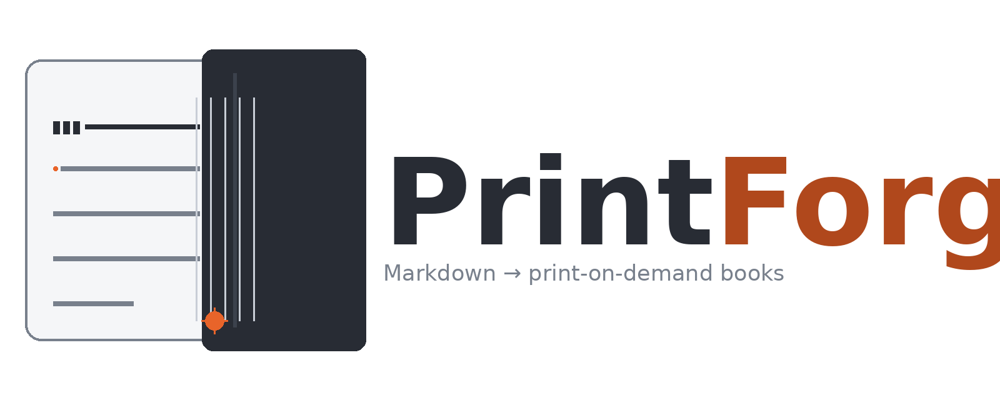

# PrintForge

**PrintForge** converts Markdown manuscripts into professionally formatted
print-on-demand books. A standalone, open-source CLI that takes the same
book structure BookForge uses and produces POD-ready output — interior PDF,
cover spec, and provider metadata — starting with **Amazon KDP**.

## What it does

- **Import** manuscripts from the BookForge convention (`book.json` + `chapters/*.md`) without modifying the originals
- **Format** them for print: trim size, bleed, margins, typography, page geometry
- **Publish** via pluggable provider profiles (KDP first)

## Status

Architecture documented — see [docs/ARCHITECTURE.md](docs/ARCHITECTURE.md).

## License

MIT

